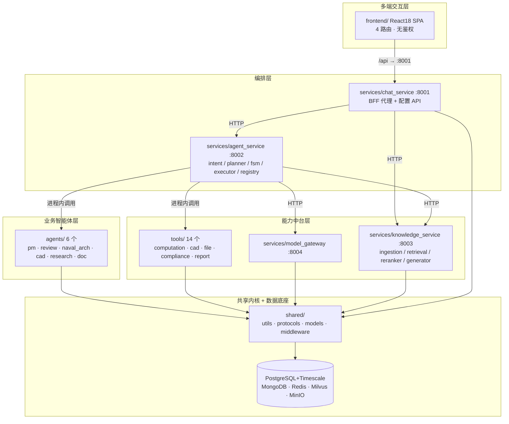
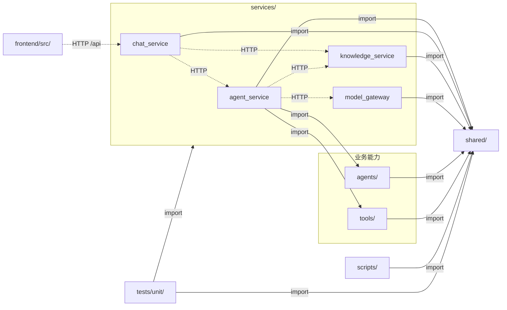
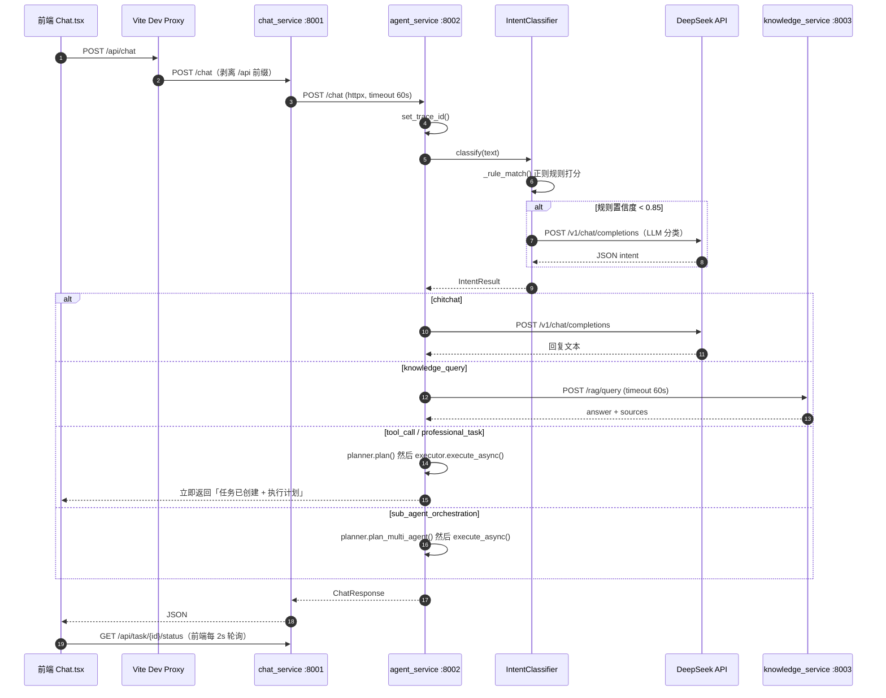
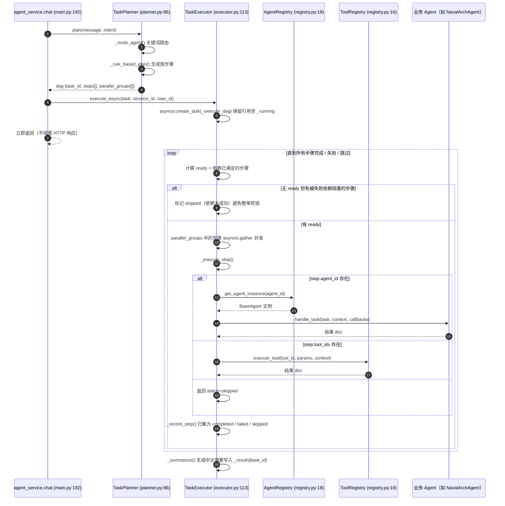
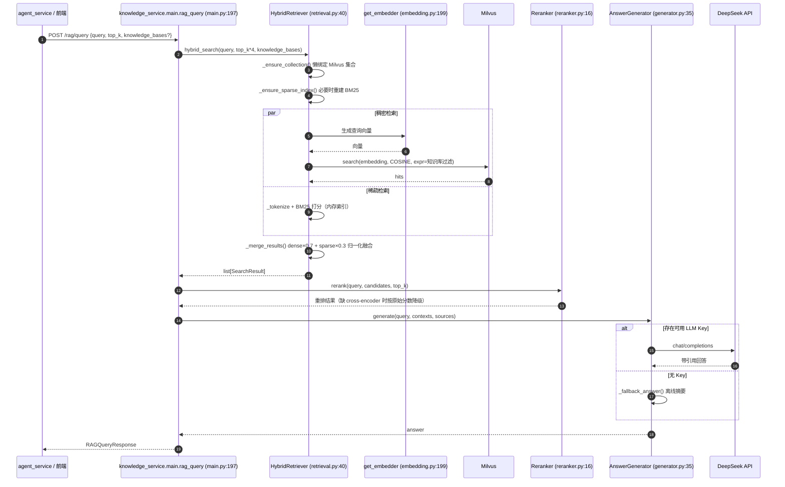
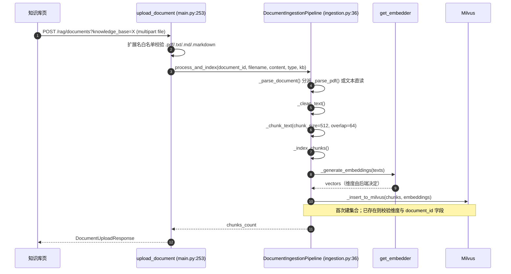
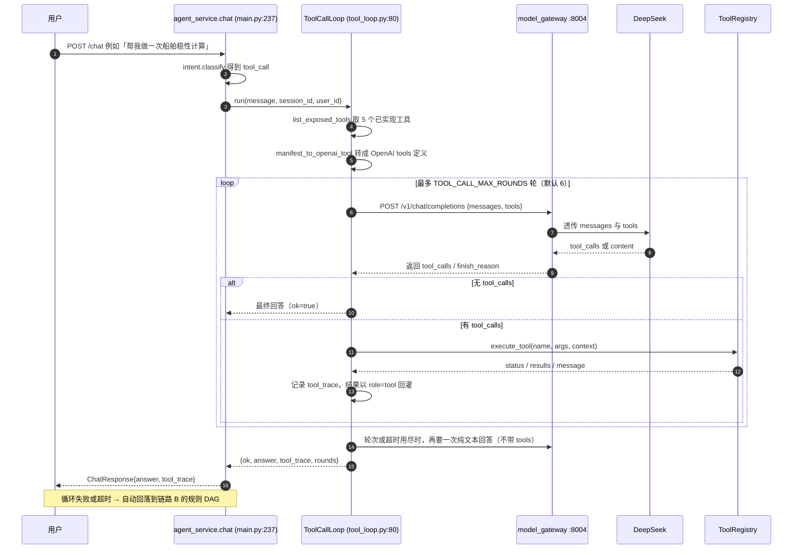

# 白草沧智（GrassSea AI）项目架构与依赖关系说明文档

> **文档定位**：让新加入的工程师在不通读全部源码的前提下，准确理解本项目的整体结构、模块边界、调用链路、接口契约与核心功能。
>
> **代码基线**：`F:\GrassSea`，分支 `feature/desktop-native`（自 `develop` 分出）；代码 **135 个文件 / 14,370 行**（Python 118 / 11,344 行，TS·TSX 17 / 3,026 行）。
> **配套文件**：[`ARCHITECTURE-APPENDIX-INDEX.md`](./ARCHITECTURE-APPENDIX-INDEX.md) —— 全文件与符号索引（由脚本机械生成，含每个函数/类的**行号与签名**）。
> **最近更新**：2026-10-16（新增「模型自主工具调用」能力后同步）
>
> **准确性约定**：本文结论均可追溯到 `文件:行号`；无法从代码确证的内容一律标注「⚠️ 待确认」。本文只描述**代码现状**，不臆测设计意图；涉及取舍处标注「设计现状」。
>
> **引用约定**：正文中的文件名若未带目录，表示该名字在仓库中**唯一**（如 `executor.py` 即 `services/agent_service/executor.py`）；全部文件的完整路径见[附录索引](./ARCHITECTURE-APPENDIX-INDEX.md)第 1 节。同名文件一律写全路径。

## 目录

| 章节 | 内容 | 位置 |
|---|---|---|
| 1 | 项目概览 | 本文 |
| 2 | 模块与文件依赖关系 | 本文 |
| 3 | 调用关系与执行流程 | 本文 |
| 4 | 接口契约 | 本文 |
| 5 · 6 | 函数与方法清单 / 类与数据结构 | [附录索引](./ARCHITECTURE-APPENDIX-INDEX.md) |

> 第 5 章（全部函数与方法，含签名与行号）与第 6 章（全部类与数据结构，含继承关系）内容穷举且随代码频繁变动，因此**单独成册**于 [附录索引](./ARCHITECTURE-APPENDIX-INDEX.md)，由脚本从源码机械生成。
| 7 | 功能与业务逻辑映射 | 本文 |
| 8 | 数据流与状态管理 | 本文 |
| 9 | 风险、坏味道与改进建议 | 本文 |
| 10 | 附录 | 本文 |

---

# 1. 项目概览

## 1.1 项目名称、定位与核心用途

| 项 | 内容 | 来源 |
|---|---|---|
| 中文名 | 白草沧智 | `ProductDesign/基础信息.md:2` |
| 英文名 | GrassSea AI | `pyproject.toml:2`（`name = "grasssea"`） |
| 版本 | 0.1.0 | `pyproject.toml:3`、`shared/utils/config.py:41` |
| 定位 | 面向**船舶与海洋工程**领域的 AI 原生多智能体协作平台 | `pyproject.toml:6`、`README.md` |
| 核心用途 | 以 LLM + 专业知识库(RAG) + 多智能体编排 + 专业工具链，覆盖概念设计→详细设计→建造→运维 | `README.md` |
| 使用定位 | **个人使用**（无鉴权、无集群部署、无 CI/CD） | `README.md`「当前状态」节 |

## 1.2 技术栈与主要语言/框架/运行时

### 后端（Python）

| 领域 | 选型 | 声明位置 |
|---|---|---|
| 语言/运行时 | Python ≥ 3.11（容器为 3.11-slim，本地 venv 为 3.12） | `pyproject.toml:4`、`infrastructure/docker/Dockerfile:5` |
| Web 框架 | FastAPI ≥ 0.110 + uvicorn[standard] | `pyproject.toml:13-14` |
| HTTP 客户端 | httpx ≥ 0.27 | `pyproject.toml:15` |
| 关系库 | SQLAlchemy 2.x（async）+ asyncpg + Alembic | `pyproject.toml:16-18` |
| 文档库 | motor（MongoDB 7） | `pyproject.toml:19` |
| 缓存 | redis ≥ 5.0 | `pyproject.toml:20` |
| 向量库 | pymilvus ≥ 2.4 | `pyproject.toml:21` |
| 消息队列 | Celery + aio-pika（RabbitMQ） | `pyproject.toml:22,30` ⚠️ **依赖已声明但代码中未接入** |
| 配置/校验 | pydantic v2 + pydantic-settings | `pyproject.toml:23-24` |
| 加密 | cryptography（Fernet） | `pyproject.toml:25` |
| 本地向量 | fastembed（ONNX，无需 torch） | `pyproject.toml:26` |
| 文档解析 | pypdf2、pymupdf、unstructured、openpyxl | `pyproject.toml:32-34,41` |
| LLM SDK | openai ≥ 1.12、tiktoken | `pyproject.toml:37-38` |
| 状态机 | transitions | `pyproject.toml:45` |
| 日志 | structlog | `pyproject.toml:43` |
| 可观测性 | opentelemetry-api/sdk/instrumentation-fastapi | `pyproject.toml:48-50` |
| 对象存储 | minio ≥ 7.2 | `pyproject.toml:47` |
| 图库 | neo4j ≥ 5.14 | `pyproject.toml:46` ⚠️ **依赖已声明但代码中未使用** |

### 前端（TypeScript）

| 领域 | 选型 | 来源 |
|---|---|---|
| 框架 | React 18.3 + TypeScript 5.4 | `frontend/package.json` |
| 构建 | Vite 5 | `frontend/vite.config.ts` |
| UI 库 | Ant Design 5 | `frontend/package.json` |
| 状态管理 | Zustand 4 | `frontend/src/stores/` |
| 路由 | react-router-dom 6 | `frontend/src/App.tsx:2` |
| 请求 | axios | `frontend/src/api/index.ts:1` |
| 数据请求 | TanStack Query 5 | `frontend/package.json` ⚠️ 代码中未实际使用 |

### 基础设施

| 组件 | 版本/镜像 | 来源 |
|---|---|---|
| PostgreSQL + TimescaleDB | `timescale/timescaledb:2.14.2-pg15` | `docker-compose.yml:9` |
| MongoDB | `mongo:7.0` | `docker-compose.yml:30` |
| Redis | `redis:7.2-alpine` | `docker-compose.yml:51` |
| MinIO | `minio/minio:latest` | `docker-compose.yml:129` |
| RabbitMQ | `rabbitmq:3.12-management-alpine` | `docker-compose.yml:150` |
| Milvus + etcd + 内部 MinIO | `milvusdb/milvus:v2.4.0` 等 | `docker-compose.yml:68,87,101` |

## 1.3 整体架构风格

**结论：分层 + 微服务（进程级拆分）+ 协议化插件（Agent/Tool 抽象）。**

| 风格特征 | 证据 |
|---|---|
| **分层** | `README.md` 定义五层：多端交互 → 智能体编排 → 业务智能体 → 能力中台 → 数据底座 |
| **微服务** | 4 个独立 FastAPI 进程，各自 `main.py` + `lifespan`：`services/model_gateway/main.py`、`chat_service`、`agent_service`、`knowledge_service` |
| **服务间通信** | 全部为 **HTTP/JSON**（httpx），无 RPC/消息总线参与业务链路 |
| **插件化（Agent）** | `shared/protocols/agent.py:55 BaseAgent` 抽象基类 + `services/agent_service/registry.py:18 AgentRegistry` 注册中心 |
| **插件化（Tool）** | `shared/protocols/tool.py:48 BaseTool` + `tools/base/registry.py:16 ToolRegistry`（含状态机 ONLINE/DEGRADED/OFFLINE） |
| **BFF 模式** | `services/chat_service/main.py` 仅做代理转发，不含业务逻辑 |
| **事件驱动** | ⚠️ 仅有 WebSocket 单向推送（`services/agent_service/main.py:260`），**无消息队列驱动**；Celery 依赖未接入 |
| **共享内核（Shared Kernel）** | 四个服务与全部 Agent/Tool 均依赖 `shared/`，构成事实上的公共内核 |



## 1.4 项目目录树（带职责注释）

```
GrassSea/
├── agents/                     # 业务智能体（6 个，全部继承 shared.protocols.agent.BaseAgent）
│   ├── base/                   #   占位目录（仅注释，真正的基类在 shared/protocols/agent.py）
│   ├── pm_agent/               #   项目经理：任务分解/资源分配(未实现) + 结果聚合(已实现)
│   ├── review_agent/           #   审查：参数阈值校验(已实现) + 报告汇总(已实现)
│   ├── naval_arch_agent/       #   船舶工程师：稳性/阻力/静水力/型线（唯一含真实公式计算的 Agent）
│   ├── cad_agent/              #   CAD：均为 not_implemented
│   ├── research_agent/         #   研究员：均为 not_implemented
│   └── doc_agent/              #   文档：均为 not_implemented
├── services/                   # 后端微服务（4 个独立进程）
│   ├── agent_service/          #   编排：main / intent / planner / fsm / executor / registry / tool_loop(模型自主调用工具)
│   ├── chat_service/           #   BFF 代理：main + config_api（配置热更新）
│   ├── knowledge_service/      #   RAG：main / ingestion / retrieval / reranker / generator
│   └── model_gateway/          #   模型网关：main / router / token_tracker
├── tools/                      # 工具库（14 个 + 注册中心 + 引导模块）
│   ├── base/registry.py        #   工具注册中心（状态机、超时、健康检查）
│   ├── bootstrap.py            #   build_tool_registry()：实例化并注册全部 21 个工具
│   ├── doc/                    #   Word 文档：docx_create / docx_edit / docx_to_pdf
│   ├── computation/            #   4 个真实计算工具：hydrostatics/stability/resistance/hull_transform
│   ├── cad/ · file/ · compliance/ · report/   #   10 个诚实占位工具（返回 not_implemented）
├── shared/                     # 共享内核（被全部服务与 Agent/Tool 依赖）
│   ├── protocols/              #   Agent / Tool 抽象协议与注册中心接口
│   ├── utils/                  #   config · logging · secrets · embedding · workspace · **docx_render** · **pdf_convert**
│   ├── models/                 #   数据模型：postgres / timescale / mongodb / repository / alembic
│   ├── vectorstore/            #   **向量存储抽象层**：base(协议) · local(内置SQLite) · milvus(服务器)
│   └── middleware/             #   security（RBAC/HMAC/审计）· observability（OTel）
├── frontend/                   # React 18 SPA
│   └── src/                    #   App.tsx(4 路由) · components(6) · pages(4) · stores(2) · api(1)
├── scripts/                    # 运维脚本：init_db · seed_data · init_minio · reset_knowledge_base · backup_db
├── tests/                      # 单元测试（5 个文件 377 行）；integration / e2e 为空壳
├── infrastructure/docker/      # Dockerfile · Dockerfile.frontend · 各中间件初始化目录
├── docs/                       # DOCKER_GUIDE.md · PROJECT_FILES.md · dev-guide/ · 本文档
├── 教学文件/                    # 非代码资产：13 阶段教程 + 附录（85 篇 md，27,776 行）
├── ProductDesign/              # 非代码资产：产品设计稿与 logo
├── AI开发提示词/                # 非代码资产：开发提示词
├── 项目开发日记/                # 非代码资产：开发日志（5 篇）
├── 练习/                        # 非代码资产：学习练习脚本（3 个 .py）
├── pyproject.toml              # 依赖声明 + ruff/pytest/mypy/alembic 配置
├── uv.lock                     # uv 锁文件（包源已指向清华镜像）
├── alembic.ini                 # 迁移配置（连接串由 env.py 从 .env 注入）
├── Makefile                    # 30 个开发目标（up/db-init/test/lint/run-* 等）
├── docker-compose.yml          # 中间件编排（8 个服务）
├── docker-compose.app.yml      # 应用编排（4 服务 + 前端，与上者组合使用）
├── .env.example                # 配置模板（无真实密钥）
└── README.md                   # 含「首次运行指引」10 步
```

> **已删除的历史文件**（勿在文档中引用）：`.github/workflows/ci.yml`、`infrastructure/k3s/*`、`docker-compose.full.yml`、`start.bat`/`stop.bat`、`services/*-service`（连字符空目录）。

## 1.5 双形态运行（桌面 / 服务器）

本项目支持两种运行形态，**同一套代码**通过配置切换，互不干扰：

| | 🖥️ 桌面形态（新增） | 🐳 服务器形态（原样保留） |
|---|---|---|
| 向量后端 | `VECTOR_BACKEND=local`（内置 SQLite + numpy） | `VECTOR_BACKEND=milvus`（Docker 中默认） |
| 外部中间件 | **零**（不需要 PostgreSQL / MongoDB / Redis / RabbitMQ / Milvus / MinIO） | PostgreSQL · MongoDB · Redis · RabbitMQ · Milvus · MinIO |
| 启动方式 | **`uv run python -m app.launcher`**（单进程跑 4 个服务）+ 原生窗口（P3 规划中） | `docker compose -f docker-compose.yml -f docker-compose.app.yml up -d` |
| 数据落盘 | `<项目根>/data/`（向量库、模型缓存、密钥；已 gitignore） | `./docker-data/`（compose 卷） |
| 适用场景 | 个人在 Windows 上直接使用 | 服务器部署、多副本、超大规模向量 |

**为什么桌面形态不需要那些中间件**（依据第 8 章的审计结论）：

| 组件 | 运行时使用情况 |
|---|---|
| PostgreSQL | ❌ 四个服务都不初始化；ORM 仅由 `scripts/` 与 Alembic 使用 |
| MongoDB | ❌ 无任何写入路径 |
| Redis | ❌ `init_redis()` 四个服务均未调用 |
| RabbitMQ / Celery | ❌ 仅配置项，无代码引用 |
| Milvus | ✅ **唯一真正在用的**——由新的可插拔向量后端替代 |
| MinIO | ❌ 仅 `scripts/init_minio.py` 使用 |

**单进程启动器**（`app/launcher.py`，227 行）：
- 一个 Python 进程内用 4 个 asyncio 任务各起一个 uvicorn，监听 127.0.0.1:8001–8004
- 跨服务地址自动由容器名改写为回环地址，且**跟随端口配置**（改 `CHAT_SERVICE_PORT` 等会同步改写内部 URL）
- 统一接管 SIGINT/SIGTERM（四个 uvicorn 实例均关闭自动信号处理，避免互相覆盖）
- `--check` 只做导入与配置自检，不监听端口
- **服务代码零改动**，四个服务仍是独立 ASGI 应用；删除 `app/` 不影响 Docker 部署

> `shared/models/database.py` 已**全面惰性化**：导入 ORM 模型不再创建 PostgreSQL 引擎，
> 外部驱动（asyncpg / motor / redis / pymilvus）改为函数内延迟导入，
> 因此桌面形态可以完全不安装、不连接这些组件。

---

# 2. 模块与文件依赖关系

## 2.1 模块划分与职责边界

| # | 模块 | 路径 | 职责边界 | 规模 |
|---|---|---|---|---|
| M1 | 共享内核 | `shared/` | 配置、日志、密钥、向量化、**向量存储抽象**、数据模型、协议、中间件。**不含业务逻辑** | 38 文件 / 3013 行 |
| M2 | 模型网关 | `services/model_gateway/` | 多模型路由、OpenAI 兼容接口、Token 统计 | 4 / 721 |
| M3 | 对话服务 | `services/chat_service/` | BFF 代理 + 配置热更新 + **附件处理** + **工作文件夹 API** + 桌面模式静态托管 | 4 / 900 |
| M4 | 智能体编排 | `services/agent_service/` | 意图识别、任务规划、FSM、DAG 执行、Agent/工具注册、**模型自主工具调用** | 8 / 2,022 |
| M5 | 知识库服务 | `services/knowledge_service/` | 文档入库、混合检索、重排、答案生成（向量后端可插拔） | 6 / 1,385 |
| M6 | 业务智能体 | `agents/` | 6 个专业 Agent，按能力粒度实现 | 13 / 573 |
| **M11** | **桌面形态** | `app/` | 单进程启动器 + 桌面窗口（分级策略）+ pythonnet 运行时配置 | 4 / ~420 |
| M7 | 工具库 | `tools/` | **21 个工具**（含 3 个工作文件夹 + 1 个 Rhino 桥接）+ 注册中心 + 引导 | 22 / 797 |
| M8 | 前端 | `frontend/src/` | SPA：4 页面 + 6 组件 + 2 store + API 封装 | 15 / 2,664 |
| M9 | 脚本 | `scripts/` | 初始化与维护脚本（非运行时） | 5 / 422 |
| M10 | 测试 | `tests/` | 单元测试 | 5 / 377 |

### 依赖方向原则

- **单向**：`services/*` → `shared/`；`agents/*` → `shared/`；`tools/*` → `shared/`。业务模块**互不直接 import**（跨服务只走 HTTP）。
- **例外**：`services/agent_service/` 是唯一直接 import `agents/` 与 `tools/` 的模块（`executor.py`、`agent_service/registry.py`、`planner.py`），因为它是编排者。
- **零反向依赖**：`shared/` 不 import 任何业务模块 ✅

## 2.2 模块级依赖图



> 实线 = 进程内 `import`；虚线 = 跨进程 HTTP。

**实际探测到的 import 边**（由脚本抽取，非人工推断）：

| 源 | 目标 |
|---|---|
| `services/agent_service` | `agents`、`tools`、`services`（自身内部模块）、`shared` |
| `services/chat_service` | `services`（自身）、`shared` |
| `services/knowledge_service` | `services`（自身）、`shared` |
| `services/model_gateway` | `services`（自身）、`shared` |
| `agents/*`（6 个） | `shared` |
| `tools/*`（含 bootstrap） | `shared`、`tools`（注册中心） |
| `shared/middleware`、`shared/models`、`shared/utils` | `shared` |
| `scripts/*` | `shared` |
| `tests/unit` | `services`、`shared` |

## 2.3 文件级依赖矩阵（关键文件）

完整逐文件依赖见[附录索引](./ARCHITECTURE-APPENDIX-INDEX.md)「内部依赖」行；下表为**关键耦合点**。

| 文件 | 直接依赖（进程内） | 被谁依赖 |
|---|---|---|
| `shared/utils/config.py` | `shared.utils.secrets` | 几乎全部模块（`get_settings()`） |
| `shared/utils/embedding.py` | `shared.utils.config`、`shared.utils.logging`、`fastembed` | `knowledge_service/ingestion.py`、`knowledge_service/retrieval.py` |
| `shared/utils/secrets.py` | `cryptography`、`shared.utils.logging` | `config.py`、`chat_service/config_api.py` |
| `shared/protocols/agent.py` | 标准库 | `agents/*`、`agent_service/registry.py`、`executor.py` |
| `shared/protocols/tool.py` | 标准库 | `tools/*`、`tools/base/registry.py` |
| `tools/base/registry.py` | `shared.protocols.tool`、`shared.utils.logging` | `tools/bootstrap.py`、`agent_service/executor.py` |
| `tools/bootstrap.py` | **全部 21 个工具类** | `agent_service/main.py`（lifespan） |
| `services/agent_service/executor.py` | `agent_service/registry`、`shared.models.postgres.task`、`shared.protocols.agent`、`tools.base.registry` | `agent_service/main.py` |
| `services/agent_service/planner.py` | `agent_service/intent`、`shared.utils.config` | `agent_service/main.py` |
| `services/agent_service/tool_loop.py` | `shared.protocols.tool`、`shared.utils.config`、`model_gateway`（HTTP） | `agent_service/main.py`（lifespan + /chat） |
| `services/knowledge_service/retrieval.py` | `shared.utils.embedding`、`shared.vectorstore` | `knowledge_service/main.py`、`generator.py` |
| `shared/vectorstore/__init__.py` | `vectorstore.base`、按配置动态导入 `local` / `milvus` | `knowledge_service` 的 ingestion 与 retrieval |
| `services/chat_service/config_api.py` | `shared.utils.secrets` | `chat_service/main.py` |
| `frontend/src/api/index.ts` | `axios` | 全部 4 个页面 + `DAGPanel` + `ToolTraceCard` |

## 2.4 循环依赖与耦合风险

| 风险 | 位置 | 等级 | 说明与建议 |
|---|---|---|---|
| **共享内核单点** | `shared/` 被 5 个上层模块依赖 | 🟠 中 | 任一处改动影响全局。建议按 `shared.utils` / `shared.models` / `shared.protocols` 三条线独立版本化 |
| **编排层直连业务实现** | `agent_service/planner.py` 硬编码 `agent_id` 与 `tool_id` 字符串（如 `"naval_arch_agent"`、`"hydrostatics"`） | 🟠 中 | 依赖倒置缺失：应通过注册中心的能力发现（`AgentRegistry.discover()`）而非字符串常量。现有 `discover()` 已实现但未被使用（`agent_service/registry.py:77`） |
| **隐式全局状态** | `services/agent_service/main.py` 的 `reload_config()` 直接 `setattr(settings, ...)` 修改 `@lru_cache` 单例；`chat_service/config_api.py` 同时写 `os.environ` | 🔴 高 | 并发下非线程安全，且配置来源双轨（pydantic 读 `.env`、代码读 `os.environ`）。建议：配置变更走单一入口 + 不可变快照替换 |
| **模块内私有访问** | 已修复 ✅ `executor.py` 曾读 `registry._agents`，现改用 `get_agent_instance()`（`agent_service/registry.py:64`） | — | 保持公开访问器约定 |
| **注册中心双份实现** | `shared/protocols/agent.py:95 AgentRegistry`（Protocol）与 `services/agent_service/registry.py:18 AgentRegistry`（实现）**同名不同物** | 🟡 低 | 命名冲突易误读。建议实现类改名 `InMemoryAgentRegistry` |
| **同名类冲突** | `retrieval.py:23 SearchResult`（普通类）与 `knowledge_service/main.py:84 SearchResult`（pydantic 模型）同名 | 🟡 低 | 已通过 `from_attributes=True` 兼容，但仍建议重命名其一 |
| **循环依赖** | 脚本抽取未发现进程内循环 import ✅ | — | — |
| **工具同名注册** | `shared/protocols/tool.py:91 ToolRegistry`（Protocol）与 `tools/base/registry.py:16 ToolRegistry`（实现）同名 | 🟡 低 | 同上 |

## 2.5 外部依赖清单

### 第三方库（运行时，37 项）

完整清单见 `pyproject.toml:13-50`。按用途归类：

| 用途 | 库 | 是否实际被代码使用 |
|---|---|---|
| Web / HTTP | fastapi、uvicorn、httpx、python-multipart、websockets | ✅ |
| 数据库 | sqlalchemy[asyncio]、asyncpg、alembic、motor | ✅（motor 仅 `shared/models/database.py`） |
| 缓存/队列 | redis、celery、aio-pika | ⚠️ redis ✅；**celery / aio-pika 未被任何代码 import** |
| 向量 | pymilvus | ✅ |
| 配置/日志 | pydantic、pydantic-settings、structlog、python-dotenv | ✅ |
| 加密 | cryptography | ✅（`shared/utils/secrets.py`） |
| 本地向量 | fastembed | ✅（`shared/utils/embedding.py`） |
| 文档解析 | pypdf2、pymupdf、openpyxl、unstructured、tiktoken | ⚠️ **前 3 项被 import 但解析逻辑未实现**；unstructured/tiktoken 未 import |
| LLM | openai、langchain、langchain-community | ⚠️ **openai 未 import**（改用 httpx 直连）；langchain 未使用 |
| 数值 | numpy、pandas | ✅ numpy（`naval_arch_agent`、计算工具）；pandas 未使用 |
| 状态机 | transitions | ✅（`agent_service/fsm.py:10`） |
| 存储 | minio、boto3 | ✅ minio（脚本）；boto3 未使用 |
| 图库 | neo4j | ❌ **未被任何代码 import** |
| 可观测性 | opentelemetry-api/sdk/instrumentation-fastapi | ✅ `shared/middleware/observability.py:49-53` |
| 重试 | tenacity | ⚠️ 未被 import |

### 中间件服务

| 服务 | 端口 | 被哪个模块使用 | 代码位置 |
|---|---|---|---|
| PostgreSQL 15 + TimescaleDB | 5432 | `shared/models/database.py` | `pg_engine` 创建于模块加载时（`database.py:22`） |
| MongoDB 7 | 27017 | `shared/models/database.py` | `init_mongodb()`（`database.py:57`） |
| Redis 7 | 6379 | `shared/models/database.py` | `init_redis()`（`database.py:85`）⚠️ 四个服务的 lifespan 均未调用 |
| Milvus 2.4 | 19530 | `knowledge_service` | `ingestion.py:45`、`retrieval.py:55` |
| MinIO | 9000 | `scripts/init_minio.py` | 运行时未使用（⚠️ 待确认是否规划中） |
| RabbitMQ | 5672 | ❌ 无代码使用 | — |

### 第三方外部 API

| 服务 | 用途 | 调用位置 |
|---|---|---|
| DeepSeek（OpenAI 兼容） | 意图分类、任务规划、反问回答、RAG 生成 | `agent_service/intent.py`、`planner.py`、`agent_service/main.py:227`；`knowledge_service/generator.py` |
| Claude / OpenAI | 模型路由表中登记，实际调用需配置 Key | `model_gateway/router.py` |
| HuggingFace（hf-mirror） | 下载本地向量模型 | `shared/utils/embedding.py:58-70` |
| Brave / Bing Search | ⚠️ 仅登记 Key，**`tools/file/web_search.py` 返回 not_implemented** | — |

---

# 3. 调用关系与执行流程

## 3.1 核心调用链路图

### 链路 A：对话请求（含意图分流）



> **说明**：上图中 `tool_call / professional_task` 分支现已**优先走链路 E（模型自主调用工具）**，仅在链路 E 不可用时才落入「创建任务 → 规则 DAG」路径。详见 3.1 链路 E 与 3.2 路径 3。


### 链路 B：任务执行（DAG 调度）



### 链路 C：RAG 检索（问答）



### 链路 D：文档入库



### 链路 E：模型自主调用工具（function calling）

> 新增能力。模型不再由规则决定调用哪个工具，而是拿到工具清单与 JSON Schema 后**自行决定**。



### 链路 E 的降级设计（重要）

| 情况 | 行为 |
|---|---|
| `TOOL_CALLING_ENABLED=false` | 直接回落规则 DAG |
| 模型网关不可达 / 模型报错 | 回落规则 DAG，并记录 reason |
| 没有可暴露的工具 | 回落规则 DAG |
| 已达最大轮次或总超时 | 去掉 tools 再要一次文本回答；仍失败则回落 |
| 上游不认识 tools 参数 | 网关自动去掉 tools 重试一次（`router.py:216` 内） |

## 3.2 关键调用路径说明

### 路径 1：POST /chat 的完整决策过程

| 步 | 调用 | 位置 | 入参 | 出参 |
|---:|---|---|---|---|
| 1 | `proxy_chat(request)` | `chat_service/main.py:60` | `Request`（原始 HTTP） | 转发到 `{AGENT_SERVICE_URL}/chat` |
| 2 | `chat(request)` | `agent_service/main.py:192` | `ChatRequest{message, session_id?, user_id?, attachments[]}` | `ChatResponse` |
| 3 | `set_trace_id(...)` | `agent_service/main.py:194` | trace 字符串 | 写入 structlog contextvars |
| 4 | `classify(text)` | `intent.py:99` | `str` | `IntentResult{intent_type, confidence, matched_rules, extracted_entities}` |
| 5a | `_handle_chitchat(message)` | `agent_service/main.py:282` | `str` | `str`（LLM 回复） |
| 5b | `_handle_knowledge_query(message, session_id)` | `agent_service/main.py:298` | `str, str` | `{answer, sources}` |
| 5c | `plan(message, intent)` | `planner.py:92` | `str, IntentResult` | `dict`（DAG） |
| 5d | `plan_multi_agent(message, intent)` | `planner.py:112` | 同上 | `dict`（DAG，可能由 LLM 生成） |
| 6 | `execute_async(task, session_id, user_id)` | `executor.py:126` | DAG、会话、用户 | `None`（后台协程） |
| 7 | `_describe_plan(task)` | `agent_service/main.py:177` | DAG | `str`（多行计划文本，回给用户） |

> **关键语义**：任务型请求立即返回（约 `agent_service/main.py:210`），执行在后台协程中进行；前端通过轮询 `GET /task/{task_id}/status` 获取进度。

### 路径 3：模型自主工具调用（新增的优先路径）

| 步 | 调用 | 位置 | 说明 |
|---:|---|---|---|
| 1 | `tool_call_loop.run(message, session_id, user_id)` | 调用点 `agent_service/main.py:261`；实现 `tool_loop.py:102` | 意图为 tool_call / professional_task 时**先走这里** |
| 2 | `list_exposed_tools()` / `openai_tools()` | `tool_loop.py:89` / `:96` | 只取 ONLINE 且在 `MODEL_EXPOSED_TOOLS` 白名单内的工具 |
| 3 | `_call_model(messages, tools)` | `tool_loop.py:175` | 经模型网关下发 tools |
| 4 | `_execute_one(call, ...)` | `tool_loop.py:201` | 解析模型给出的 arguments → `execute_tool` → 记录 trace → 回灌 role=tool 消息 |
| 5 | `_finalize(...)` | `tool_loop.py:255` | 轮次或超时用尽时去掉 tools 再要一次文本回答 |
| 6 | 失败回落 | `agent_service/main.py:274` 附近 | 回落到下方的规则规划路径 |

### 路径 2：_execute_step 的分派规则

| 条件 | 行为 | 位置 |
|---|---|---|
| `step["agent_id"]` 非空 | `registry.get_agent_instance(agent_id)` 然后 `agent.handle_task(task, context, callbacks)` | `executor.py:376` |
| 否则 `step["tool_ids"]` 非空 | 取第一个已注册工具，调用 `tool_registry.execute_tool(tool_id, params, context)` | `executor.py:376` |
| 都没有 | 返回 `{"status": "skipped", "reason": "步骤未指定 agent_id 或 tool_ids"}` | 同上 |

**步骤结果归集规则**（`_record_step`）：

| 步骤返回的 status | 归入 | 说明 |
|---|---|---|
| `skipped` / `not_implemented` | `skipped` | 能力尚未实现视为未执行，而非失败 |
| `error` / `failed` | `failed` | 真正报错 |
| 其他 | `completed` | 成功 |

**任务最终状态**（约 `executor.py:180`）：存在真正失败，或 `completed` 列表为空，则 `failed`；否则 `completed`（允许部分步骤因能力未实现而跳过）。

## 3.3 异步 / 并发 / 事件机制

| 机制 | 实现 | 位置 | 说明 |
|---|---|---|---|
| ASGI 事件循环 | uvicorn + asyncio | 各服务 `main.py` | 全部 I/O 为 async |
| 后台任务 | `asyncio.create_task(_execute_dag)` + `_running` 引用表 + `add_done_callback` 清理 | `executor.py:139-145` | 曾因未保留引用有被 GC 风险，已修复 |
| 并发执行 | `asyncio.gather(*tasks, return_exceptions=True)` | `executor.py:147` 内 | 由 `task["parallel_groups"]` 决定 |
| 取消 | `cancel_task()` 置 `_cancelled` 标记并 `cancel()`；DAG 循环每轮检查 | `executor.py:525` | 取消真正生效 |
| WebSocket | `@app.websocket("/ws/{session_id}")` | `agent_service/main.py:261` | 服务端单向推送；⚠️ 前端无 WebSocket 客户端，该端点当前无消费者 |
| 回调 | `AgentCallbacks{on_progress, on_message, on_error}` | `shared/protocols/agent.py:45` | 由 `_build_callbacks()`（`executor.py:478`）注入 |
| 定时 / 轮询 | 前端 `setInterval` 2s（Chat）、3s（TaskCenter、DAGPanel） | `frontend/src/pages/Chat.tsx`、`TaskCenter.tsx`、`components/DAGPanel.tsx` | 无服务端定时任务 |
| 消息队列 | 代码中未使用 | — | Celery / aio-pika 仅声明依赖 |
| 重试 | `_propagate_all_secrets(max_retries=5, retry_delay=3.0)` | `chat_service/config_api.py:169` | 仅在对话服务启动时 |

## 3.4 生命周期说明

### 启动阶段（以 agent_service 为例，`agent_service/main.py:41 lifespan`）

| 顺序 | 动作 | 位置 |
|---:|---|---|
| 1 | `setup_logging(level=DEBUG if APP_DEBUG)` | `agent_service/main.py:43` |
| 2 | 构造 `IntentClassifier` / `TaskPlanner` / `AgentRegistry` / `TaskExecutor` | `agent_service/main.py:46-50` |
| 3 | `await agent_registry.initialize()` 注册并实例化 6 个 Agent | `agent_service/registry.py:28` |
| 4 | `await intent_classifier.initialize()` | `intent.py:96` |
| 5 | `tool_registry = await build_tool_registry()` 注册 21 个工具 | `tools/bootstrap.py:53`，调用点约 `agent_service/main.py:56` |
| 6 | 记录启动日志（含 registered_tools 计数） | `agent_service/main.py` 日志 |

### 运行阶段

- 无状态 HTTP 处理；任务状态保存在 `TaskExecutor._tasks` / `_results` 的进程内存中。
- ⚠️ 重要语义：任务不落库、不跨进程，服务重启即丢失；多副本部署时轮询可能路由到错误实例。

### 关闭阶段

| 服务 | 清理动作 | 位置 |
|---|---|---|
| `knowledge_service` | `ingestion_pipeline.close()`、`retriever.close()`（断开 Milvus） | `knowledge_service/main.py:39 lifespan` |
| `model_gateway` | `router.close()` | `model_gateway/main.py:33 lifespan` |
| `agent_service` | 仅记录日志，无显式清理 | `agent_service/main.py:41` |
| `chat_service` | 仅记录日志 | `chat_service/main.py:27` |

---

# 4. 接口契约

## 4.1 对外 HTTP API（前端可见）

> 前端统一以 `/api` 为前缀，由 Vite 代理剥离后转发至 `chat_service:8001`（`frontend/vite.config.ts:11`）。

| 方法 | 路径 | 处理函数 | 位置 | 请求 | 响应 |
|---|---|---|---|---|---|
| GET | `/health` | `health` | `chat_service/main.py:53` | — | `{status, service, version}` |
| POST | `/chat` | `proxy_chat` | `chat_service/main.py:60` | `{message, session_id?, user_id?, attachments[]}` | `ChatResponse` |
| POST | `/rag/query` | `proxy_rag_query` | `chat_service/main.py:71` | `{query, top_k?, knowledge_bases?}` | `RAGQueryResponse` |
| POST | `/rag/documents` | `proxy_rag_upload` | `chat_service/main.py:82` | multipart `file` + query `knowledge_base` | `DocumentUploadResponse` |
| GET | `/rag/documents` | `proxy_rag_documents` | `chat_service/main.py:103` | query `knowledge_base?` | `{total, documents[]}` |
| DELETE | `/rag/documents/{document_id}` | `proxy_rag_delete` | `chat_service/main.py:114` | 路径参数 | `{document_id, deleted_chunks, status}` |
| GET | `/tasks` | `proxy_tasks` | `chat_service/main.py:124` | — | `{total, tasks[]}` |
| GET | `/agents` | `proxy_agents` | `chat_service/main.py:132` | — | `{total, agents[]}` |
| GET | `/tools` | `proxy_tools` | `chat_service/main.py:139` | — | `{total, tool_calling_enabled, exposed_to_model, tools[]}` |
| GET | `/task/{task_id}/status` | `proxy_task_status` | `chat_service/main.py:140` | 路径参数 | `{task_id, status, progress, result, error, steps[]}` |
| GET | `/config/schema` | `get_config_schema` | `chat_service/config_api.py:204` | — | `ConfigItemResponse[]` |
| PUT | `/config/update` | `update_config` | `chat_service/config_api.py:225` | `ConfigUpdateRequest{key, value}` | `{status, ...}` |
| POST | `/config/test-llm` | `test_llm_connection` | `chat_service/config_api.py:281` | — | `{ok, message}` |

## 4.2 各服务自身 API（容器内可见）

### agent_service :8002（`services/agent_service/main.py`）

| 方法 | 路径 | 函数 | 行号 | 说明 |
|---|---|---|---:|---|
| GET | `/health` | `health` | 97 | 返回 registered_agents / registered_tools |
| GET | `/tasks` | `list_tasks` | 109 | 内存任务列表 |
| GET | `/agents` | `list_agents` | 116 | 已注册 Agent |
| GET | `/tools` | `list_tool_definitions` | 131 | 全部工具 + 是否已暴露给模型自主调用 |

### chat_service 新增端点（P3）

| 方法 | 路径 | 说明 | 可用条件 |
|---|---|---|---|
| POST | `/attachments` | 上传附件并提取正文（50MB 上限） | 始终 |
| GET | `/attachments/limits` | 附件限制说明（含图片不可解析声明） | 始终 |
| GET | `/desktop/status` | 桌面模式与工作文件夹状态 | 始终 |
| GET | `/workspace` | 当前工作文件夹与目录树摘要 | `DESKTOP_MODE=true` |
| GET | `/workspace/list` | 列出目录（只列一层） | `DESKTOP_MODE=true` |
| POST | `/workspace/set` | 直接设置工作文件夹路径 | `DESKTOP_MODE=true` |
| POST | `/workspace/select` | 弹出系统原生文件夹对话框 | `DESKTOP_MODE=true` |

> 桌面模式下 chat_service 还托管 `frontend/dist`（含 SPA 回退），并内置 `/api` 前缀剥离中间件
> ——Docker 形态下这两件事由 nginx 完成。
| GET | `/admin/status` | `admin_status` | 123 | 配置状态（⚠️ 无鉴权） |
| POST | `/admin/reload` | `reload_config` | 135 | 直接 setattr 修改全局 Settings（⚠️ 无鉴权，见第 9 章） |
| POST | `/chat` | `chat` | 192 | 主编排入口 |
| GET | `/task/{task_id}/status` | `get_task_status` | 252 | 任务状态 |
| WS | `/ws/{session_id}` | `websocket_endpoint` | 261 | 进度推送（⚠️ 前端未接入） |

### knowledge_service :8003（`services/knowledge_service/main.py`）

| 方法 | 路径 | 函数 | 行号 |
|---|---|---|---:|
| GET | `/health` | `health_check` | 140 |
| GET | `/admin/status` | `admin_status` | 150 |
| POST | `/admin/reload` | `reload_config` | 162 |
| POST | `/rag/query` | `rag_query` | 197 |
| POST | `/rag/documents` | `upload_document` | 253 |
| GET | `/rag/documents` | `list_documents` | 302 |
| DELETE | `/rag/documents/{document_id}` | `delete_document` | 311 |
| GET | `/rag/documents/{document_id}/status` | `get_document_status` | 326 |

### model_gateway :8004（`services/model_gateway/main.py`）

| 方法 | 路径 | 函数 | 行号 |
|---|---|---|---:|
| GET | `/health` | `health_check` | 100 |
| GET | `/version` | `version` | 110 |
| GET | `/admin/models` | `list_models` | 120 |
| POST | `/admin/reload` | `reload_config` | 139 |
| POST | `/v1/chat/completions` | `chat_completions` | 183 |

## 4.3 模块间接口（抽象协议）

### BaseAgent（`shared/protocols/agent.py:55`）

| 成员 | 签名 | 语义 |
|---|---|---|
| `handle_task`（抽象） | `async (self, task: dict, context: dict, callbacks: AgentCallbacks) -> dict` | 每个 Agent 必须实现；返回 dict 且必须含 `status` 字段 |
| `health_check` | `async (self) -> bool` | 默认返回 `True` |
| `set_status` / `metadata` / `status` | 属性与方法 | 状态机由基类维护 |

**返回契约（由编排层约定，非强类型）**

| status 取值 | 编排层解释 |
|---|---|
| `completed` | 计入成功 |
| `not_implemented` + `message` | 计入跳过，`message` 会透出给用户 |
| `failed` / `error` | 计入失败 |

### BaseTool（`shared/protocols/tool.py:48`）与 ToolRegistry.execute_tool（`tools/base/registry.py:64`）

| 成员 | 签名 | 约束 |
|---|---|---|
| `execute`（抽象） | `async (self, params: dict, context: dict) -> dict` | 返回 dict |
| `manifest` | `ToolManifest` | `_validate_tool()`（`tools/base/registry.py:105`）要求 `input_schema` / `output_schema` 非空 |
| `execute_tool` | `async (self, tool_id, params, context) -> dict` | 仅当工具状态为 `ONLINE` 才执行，否则返回错误 dict |

### 工具调用契约（模型 ↔ 平台）

**① 平台 → 模型**：`ToolManifest` 转成 OpenAI tools 定义（`tool_loop.py:64 manifest_to_openai_tool`）

```json
{
  "type": "function",
  "function": {
    "name": "stability",
    "description": "完整稳性、破舱稳性分析，含横摇周期、复原力臂",
    "parameters": { "type": "object", "properties": { "B": {"type": "number"}, "T": {"type": "number"} } }
  }
}
```

| 映射关系 | 来源字段 | 说明 |
|---|---|---|
| `function.name` | `manifest.tool_id` | 模型用这个名字发起调用 |
| `function.description` | `manifest.description` | 模型据此判断何时该用 |
| `function.parameters` | `manifest.input_schema` | **结构同构，零转换** |

**② 模型 → 平台**：`tool_calls` 数组

```json
{ "id": "call_1", "type": "function", "function": { "name": "stability", "arguments": "{\"B\":15,\"T\":5}" } }
```

**③ 平台 → 模型**：执行结果以 `role="tool"` 消息回灌

```json
{ "role": "tool", "tool_call_id": "call_1", "name": "stability", "content": "{\"status\":\"completed\",\"results\":{...}}" }
```

| 约束 | 取值 | 位置 |
|---|---|---|
| 最大轮次 | `TOOL_CALL_MAX_ROUNDS`（默认 6） | `tool_loop.py:102` |
| 循环总超时 | `TOOL_CALL_TIMEOUT_SECONDS`（默认 120s） | 同上 |
| 单次工具超时 | `manifest.timeout_ms` | `tools/base/registry.py:75` |
| 结果回灌上限 | 6000 字符 | `tool_loop.py:201` 内 |
| 暴露范围 | `MODEL_EXPOSED_TOOLS`（5 个），或 `TOOL_CALL_EXPOSE_UNIMPLEMENTED=true` 全暴露 | `tool_loop.py:55` |
| 模型给出的参数非法 | 退化为空参数 `{}` 并记日志，不中断循环 | `tool_loop.py:201` |
| provider 不支持 tools | 网关剥离 tools 后重试一次 | `router.py:181` |


> 文档相关端点：`GET /doc/status`、`POST /doc/open-folder`、`GET|PUT /config/template`。
> 设置页可编辑 26 项配置（中英双语标签）。

## 4.4 数据访问接口

| 接口 | 位置 | 语义 | 备注 |
|---|---|---|---|
| `Base`（DeclarativeBase） | `shared/models/database.py:37` | 全部 ORM 模型的基类 | 模块加载即创建 `pg_engine`（`database.py:22`） |
| `get_pg_session()` | `database.py:42` | FastAPI 依赖注入；异常时 rollback | 自动 commit |
| `get_mongo_db()` / `get_redis()` | `database.py:77` / `109` | 取已初始化客户端 | 未初始化时抛 `RuntimeError` |
| `BaseRepository` 及 3 个实现 | `shared/models/repository/` | 项目 / 任务 / 会话仓储 | ⚠️ 四个服务均未调用，属预留 |
| **`VectorStore` 抽象** | `shared/vectorstore/base.py` | 向量存取的统一协议：`upsert / search / fetch_all / delete_document / count / close` | 上层（ingestion / retrieval）**只依赖此协议** |
| `LocalVectorStore`（默认） | `shared/vectorstore/local.py` | SQLite 表 `chunks` + numpy 精确余弦检索 | 零外部依赖；`VECTOR_BACKEND=local` |
| `MilvusVectorStore` | `shared/vectorstore/milvus.py` | Milvus 集合 `grasssea_knowledge`；字段 `id / document_id / text / embedding / knowledge_base / filename / chunk_index` | `VECTOR_BACKEND=milvus` |

## 4.5 第三方集成接口

| 集成 | 调用形式 | 位置 | 失败语义 |
|---|---|---|---|
| DeepSeek Chat Completions | `POST {DEEPSEEK_BASE_URL}/v1/chat/completions` | `intent.py:178`、`planner.py:360`、`agent_service/main.py:282`、`generator.py:116` | 捕获异常后走规则 / 降级分支 |
| OpenAI 兼容 Embeddings | `POST {OPENAI_BASE_URL}/embeddings` | `embedding.py:110` | 失败则回退到下一个后端 |
| HuggingFace 模型下载 | `fastembed` + `HF_ENDPOINT` | `embedding.py:61-70` | 失败则回退 `hash` 词法向量（`embedding.py:127`） |
| Milvus | pymilvus ORM 风格 API | `ingestion.py:48`、`retrieval.py:56` | 连接失败仅告警，检索返回空 |
| **模型网关（内部）** | `POST {MODEL_GATEWAY_URL}/v1/chat/completions` | `tool_loop.py:175` | 支持 `tools` / `tool_calls` 透传；上游拒绝时自动降级 |
| MinIO | `minio` SDK | `scripts/init_minio.py` | 脚本级 |
| Brave / Bing 搜索 | 仅登记 Key | `tools/file/web_search.py` 返回 not_implemented | — |

## 4.6 错误与幂等性约定（横向）

| 维度 | 现状 | 证据 |
|---|---|---|
| 错误返回 | FastAPI 默认 `{"detail": ...}`；知识库服务对 404 显式 `HTTPException` | `knowledge_service/main.py:311` |
| 幂等 | `init_db.py` / `seed_data.py` 幂等（按 key 查询后再写入） | `scripts/init_db.py`、`scripts/seed_data.py` |
| 事务 | `get_pg_session()` 异常回滚；`init_db.py` 使用 `engine.begin()` | `database.py:42` |
| 并发安全 | ⚠️ `reload_config` 直接改全局单例，非线程安全 | `agent_service/main.py:135`、`knowledge_service/main.py:162` |
| 版本兼容 | 仅 `model_gateway` 暴露 `/version`；其余服务版本随 `APP_VERSION` | `model_gateway/main.py:110` |
| 鉴权 | ❌ 全部端点无鉴权（设计现状：个人使用） | 第 9 章详述 |

---

# 7. 功能与业务逻辑映射

## 7.1 功能清单（含真实实现状态）

> 状态口径：**已实现** = 返回真实计算结果/数据；**未实现** = 返回 `{"status":"not_implemented", "message": ...}`，不编造任何产物（这是项目的硬性约定，见 `agents/*/agent.py` 各处注释）。

### 业务智能体能力（6 个 Agent / 13 项能力）

| Agent | 能力（action） | 状态 | 位置 |
|---|---|---|---|
| `naval_arch_agent` | `stability_calc` 稳性计算 | ✅ 已实现（真实公式） | `agents/naval_arch_agent/agent.py:46` |
| | `hull_design` 型线设计 | ✅ 已实现（母型船变换法） | `naval_arch_agent/agent.py:95` |
| | `resistance_calc` 阻力计算 | ✅ 已实现（ITTC-57） | `naval_arch_agent/agent.py:109` |
| | `general_analysis` 综合分析 | ✅ 已实现（转入稳性分支） | `naval_arch_agent/agent.py:139` |
| `review_agent` | `regulation_check` 参数合规检查 | ✅ 已实现（**内置启发式阈值**，非规范条文） | `agents/review_agent/agent.py:82` |
| | `report_generation` 审查报告 | ✅ 已实现（汇总既有检查结果） | `agents/review_agent/agent.py` |
| `pm_agent` | `task_decomposition` 任务分解 | ❌ 未实现 | `agents/pm_agent/agent.py:76` |
| | `resource_allocation` 资源分配 | ❌ 未实现 | `pm_agent/agent.py:85` |
| | `progress_aggregation` 结果聚合 | ✅ 已实现 | `agents/pm_agent/agent.py` |
| `cad_agent` | `cad_draw` 型线绘制 / `cad_parse` 图纸解析 | ❌ 未实现 | `agents/cad_agent/agent.py:34,41` |
| `research_agent` | `literature_search` / `daily_brief` / `trend_analysis` | ❌ 未实现 | `agents/research_agent/agent.py:37,44,51` |
| `doc_agent` | `report_gen` / `format_check` | ❌ 未实现 | `agents/doc_agent/agent.py:34,41` |

### 工具能力（14 个）

| 工具 | 类别 | 状态 |
|---|---|---|
| `hydrostatics` 静水力 | computation | ✅ |
| `stability` 稳性 | computation | ✅ |
| `resistance` 阻力 | computation | ✅ |
| `hull_transform` 型线变换 | computation | ✅ |
| `reg_check` 规范审查 | compliance | ⚠️ 已实现但基于内置阈值 |
| `pdf_parser` / `xlsx_parser` / `ocr_engine` | file | ❌ |
| `todo_manager` | file | ❌ |
| `web_search` | file | ❌ |
| `cad_draw` / `cad_parse` / `dwg_converter` | cad | ❌ |
| `report_gen` | report | ❌ |

> 注册入口：`tools/bootstrap.py:35 TOOL_CLASSES`；可执行判定：`services/agent_service/planner.py:128 IMPLEMENTED_TOOLS`。

### 平台功能

| 功能 | 状态 | 主要实现 |
|---|---|---|
| 自然语言对话 | ✅ | `agent_service/main.py:192` + `model_gateway` |
| 意图识别（规则 + LLM 双通道） | ✅ | `agent_service/intent.py:99` |
| 单智能体任务编排 | ✅ | `planner.py:187` |
| 多智能体协同编排 | ✅ | `planner.py:112`（无 Key 时走 `_rule_based_multi_plan`） |
| DAG 并发执行 + 依赖旁路 | ✅ | `executor.py:147` |
| 任务状态轮询与拓扑可视化 | ✅ | `executor.py:511` + `frontend/src/components/DAGPanel.tsx` |
| 知识库上传 / 列表 / 删除 | ✅ | `knowledge_service/main.py:253,302,311` |
| 混合检索（稠密 + BM25 稀疏） | ✅ | `retrieval.py:94` |
| 重排 | ✅（降级可用） | `reranker.py:41` |
| 带引用答案生成 + 离线降级 | ✅ | `generator.py:49` |
| 配置热更新（加密存储 API Key） | ✅ | `chat_service/config_api.py:225` |
| 任务结果中文摘要 | ✅ | `executor.py:302` |
| **模型自主调用工具**（function calling） | ✅ | `tool_loop.py:102` + `model_gateway/main.py:75` |
| 工具调用轨迹展示 | ✅ | `frontend/src/components/ToolTraceCard.tsx` |
| 待办 / 报告 / 文献 / CAD / OCR | ❌ | 对应 Agent 与工具均为 not_implemented |
| 用户鉴权 / 多租户 | ❌ | 设计现状：个人使用 |

## 7.2 功能 → 代码映射

| 功能 | 参与文件 |
|---|---|
| **对话问答** | `Chat.tsx` → `api/index.ts` → `chat_service/main.py:60` → `agent_service/main.py:192` → `intent.py:99` → 分支 |
| **专业计算** | `agent_service/main.py:192` → `planner.py:187` → `executor.py:376` → `naval_arch_agent/agent.py:33` → `_stability_calculation` 等 |
| **知识问答** | `agent_service/main.py:298` → `knowledge_service/main.py:197` → `retrieval.py:94` → `reranker.py:41` → `generator.py:49` |
| **文档入库** | `KnowledgeBase.tsx` → `chat_service/main.py:82` → `knowledge_service/main.py:253` → `ingestion.py:73` → Milvus |
| **任务拓扑** | `DAGPanel.tsx` → `api/index.ts` → `chat_service/main.py:140` → `agent_service/main.py:252` → `executor.py:511` |
| **配置管理** | `Settings.tsx` → `config_api.py:225` → `secrets.py:115 save_secrets` → Fernet 加密落盘 + 向各服务 `/admin/reload` 推送 |
| **向量化** | `embedding.py:199 get_embedder` → `LocalEmbedder` / `OpenAIEmbedder` / `HashEmbedder` |

## 7.3 业务规则与约束（关键）

| 规则 | 实现位置 | 说明 |
|---|---|---|
| 意图置信度阈值 | `intent.py:99` | 规则命中置信度 ≥ 0.85 时不再调用 LLM |
| 疑问句优先知识检索 | `intent.py:119 _rule_match` | 含「什么/怎么/如何/规定/？」等 → `knowledge_query`；除非有明确动作词 |
| 未实现能力如实返回 | `agents/*/agent.py` | 返回 `not_implemented` + 中文原因，**不返回任何伪造的文件路径、规范条款号、文献条目** |
| 步骤跳过 ≠ 失败 | `executor.py` `_record_step` | `not_implemented` 归入 skipped |
| 依赖旁路 | `planner.py:307 _normalize_llm_plan` | 把不可执行步骤从依赖链摘除，防止整单死锁 |
| 工具可执行白名单 | `planner.py:128` / `planner.py:291` | 仅白名单内的工具/动作会被规则路径派发 |
| **模型可用工具白名单** | `tool_loop.py:55 MODEL_EXPOSED_TOOLS` | 默认暴露 **8 个**：5 个已实现计算/核查工具 + 3 个工作文件夹工具（后者仅在桌面模式且已选目录时真正执行） |
| **工具调用总开关** | `config.py:177 TOOL_CALLING_ENABLED` | 关闭后 `/chat` 完全回到规则规划路径 |
| 上传类型白名单 | `knowledge_service/main.py:253` | `.pdf / .txt / .md / .markdown` |
| 知识库过滤 | `retrieval.py:94` | `knowledge_bases=None` 时检索全部，否则按 `expr` 过滤 |
| 稀疏检索窗口上限 | `retrieval.py` `_ensure_sparse_index` | Milvus `limit` 上限 16384，超出报错（已规避） |
| 嵌入维度一致性 | `ingestion.py:262` | 维度或 `document_id` 字段不符时拒绝写入 |
| 降级链 | `embedding.py` | local → openai → hash（词法，`semantic=False`） |
| 限流 / 缓存 | ❌ 未实现 | 无速率限制、无响应缓存 |

## 7.4 配置项说明

配置来源：`.env` → `pydantic-settings`（`shared/utils/config.py:40-182`）→ `get_settings()` 单例（`@lru_cache`）。

| 分组 | 关键项 | 默认值 | 影响范围 |
|---|---|---|---|
| 应用 | `APP_NAME` / `APP_VERSION` / `APP_ENV` / `APP_DEBUG` | GrassSea / 0.1.0 / development / True | 全局 |
| 端口 | `CHAT_SERVICE_PORT` 等 4 项 | 8001-8004 | 各服务 |
| PostgreSQL | `POSTGRES_HOST/PORT/USER/PASSWORD/DB` | localhost / 5432 / grasssea / grasssea / grasssea | `database.py` |
| MongoDB | `MONGODB_*` | localhost / 27017 / grasssea | `database.py` |
| Redis | `REDIS_HOST/PORT/PASSWORD/DB` | localhost / 6379 / 空 / 0 | `database.py` |
| Milvus | `MILVUS_HOST/PORT` | localhost / 19530 | `knowledge_service` |
| MinIO | `MINIO_*` | localhost / 9000 / grasssea-admin / grasssea-admin-secret / grasssea-files | `init_minio.py` |
| RabbitMQ | `RABBITMQ_*` | localhost / 5672 / grasssea | **无代码使用** |
| LLM | `DEEPSEEK_API_KEY` / `DEEPSEEK_BASE_URL` | 空 / https://api.deepseek.com | 意图、规划、生成 |
| | `CLAUDE_API_KEY` / `OPENAI_API_KEY` | 空 | 模型网关路由 |
| 向量化 | `EMBEDDING_PROVIDER` / `EMBEDDING_MODEL` / `EMBEDDING_DIM` | auto / text-embedding-3-large / 3072 | `embedding.py` |
| | `LOCAL_EMBEDDING_MODEL` / `LOCAL_EMBEDDING_CACHE` / `HF_ENDPOINT` | BAAI/bge-small-zh-v1.5 / 空 / https://hf-mirror.com | 本地向量 |
| 服务发现 | `MODEL_GATEWAY_URL` / `AGENT_SERVICE_URL` / `KNOWLEDGE_SERVICE_URL` | localhost:8004/8002/8003 | 跨服务调用 |
| 密钥 | `SECRETS_DIR` | 空 → 自动探测 `docker-data/secrets` | `secrets.py:33` |
| **桌面模式** | `DESKTOP_MODE` | false | 由 `--desktop` 置 true；开启后启用工作文件夹与原生对话框 |
| | `WORKSPACE_ROOT` | 空 | 预置工作文件夹（留空则界面选择） |
| **向量后端** | `VECTOR_BACKEND` | local（代码默认）/ milvus（Docker 默认） | 决定 RAG 底层存储；桌面用 local，服务器用 milvus |
| | `VECTOR_STORE_PATH` | 空 | 向量库文件路径；空则用 `<DATA_DIR>/vectorstore/knowledge.sqlite3` |
| | `DATA_DIR` | 空 | 本地数据目录；空则用 `<项目根>/data` |
| **工具调用** | `TOOL_CALLING_ENABLED` | true | 是否允许模型自主调用工具 |
| | `TOOL_CALL_MAX_ROUNDS` | 6 | 最多几轮「思考 → 调用 → 回灌」 |
| | `TOOL_CALL_TIMEOUT_SECONDS` | 120 | 循环总超时 |
| | `TOOL_CALL_MODEL` | deepseek-chat | 工具调用使用的模型 |
| | `TOOL_CALL_EXPOSE_UNIMPLEMENTED` | false | 是否把未实现工具也暴露给模型 |

> ⚠️ 安全相关：`is_usable_key()`（`config.py`）会把 `your-xxx` 一类占位符判为不可用；`get_settings()` 会把解密后的密钥写入 `os.environ` 并覆盖占位符。

---

# 8. 数据流与状态管理

## 8.1 数据从输入到持久化的完整路径

| 数据类型 | 流转路径 | 是否落库 |
|---|---|---|
| **对话消息** | 前端 → chat_service → agent_service → 返回；**不持久化** | ❌ 仅进程内存（前端 `chatStore` 为 zustand，刷新即丢） |
| **任务与步骤** | planner 生成 DAG → `TaskExecutor._tasks` / `_results` | ❌ **仅进程内存，服务重启即丢失** |
| **知识文档** | 上传 → 解析 → 分块 → 向量化 → Milvus | ✅ Milvus（`grasssea_knowledge` 集合） |
| **系统配置** | Settings 页 → `config_api.update_config` → `_write_env()` 写 `.env` + `save_secrets()` 写 `docker-data/secrets/.grasssea_secrets` | ✅ 文件 + Fernet 加密 |
| **ORM 实体** | 无运行时写入 ⚠️ | 表已建，但四个服务**均未调用**仓储层 |
| **指标** | 未实现写入路径 | TimescaleDB 超表已建，无写入代码 |

## 8.2 全局 / 共享状态与缓存

| 状态 | 载体 | 生命周期 | 一致性策略 |
|---|---|---|---|
| `Settings` 单例 | `get_settings()` + `@lru_cache`（`config.py`） | 进程级，`cache_clear()` 前不变 | ⚠️ `reload_config` 直接 `setattr` 修改，非线程安全 |
| 密钥 | `os.environ` + `docker-data/secrets/.grasssea_secrets`（Fernet） | 进程级 + 磁盘 | 单机；密钥文件与加密文件需同时保护 |
| Agent 实例表 | `AgentRegistry._instances`（`agent_service/registry.py:24`） | 进程级 | 启动时一次性注册 |
| 工具实例表 | `ToolRegistry._tools`（`tools/base/registry.py:20`） | 进程级 | 启动时一次性注册 + 健康检查 |
| 任务状态 | `TaskExecutor._tasks` / `_results` / `_running` | 进程级 | 无共享；⚠️ 多副本不可用 |
| BM25 稀疏索引 | `retrieval.py` 内存字典 | 进程级 | 懒构建，数据变更后 `_rebuild_sparse_index()` |
| Embedder 单例 | `get_embedder()`（`embedding.py:199`） | 进程级 | 模型只加载一次 |
| 前端状态 | `chatStore.ts` / `uiStore.ts`（zustand） | 页面会话 | 无持久化 |

### 向量存储（可插拔）

`shared/vectorstore/` 把「向量存取」与具体后端解耦，上层 RAG 流程完全后端无关：

~~~mermaid
graph LR
  ING["knowledge_service/ingestion.py"] --> VS["vectorstore/__init__.py<br/>get_vector_store()"]
  RET["knowledge_service/retrieval.py"] --> VS
  VS -->|"VECTOR_BACKEND=local"| L["LocalVectorStore<br/>SQLite + numpy 精确余弦"]
  VS -->|"VECTOR_BACKEND=milvus"| M["MilvusVectorStore<br/>Milvus 2.4 + COSINE/IVF_FLAT"]
  L --> F1[("data/vectorstore/knowledge.sqlite3")]
  M --> F2[("Milvus collection<br/>grasssea_knowledge")]
~~~

| 后端 | 持久化 | 检索方式 | 依赖 | 适用 |
|---|---|---|---|---|
| `local`（默认） | 单个 SQLite 文件，向量以 float32 小端字节串存储 | numpy 暴力余弦，个人规模毫秒级、**精确无近似** | 仅 `sqlite3`(标准库) + `numpy` | 桌面 / 个人使用 |
| `milvus` | Milvus 集合 | ANN 近似检索（IVF_FLAT） | pymilvus + Milvus 服务 | 服务器 / 大规模 |

**保持不变的部分**：BM25 稀疏索引、`dense×0.7 + sparse×0.3` 融合、重排、生成与降级，全部逻辑一行未改，只把数据来源从 Milvus 换成协议调用。

**维度一致性**：两种后端都会在向量维度与索引不一致时抛出带中文指引的 `RuntimeError`（提示执行 `scripts/reset_knowledge_base.py` 后重新入库）。

## 8.3 数据库表与代码实体映射

**PostgreSQL（public schema，ORM 定义于 `shared/models/postgres/`）**

| 表 | ORM 类位置 | 用途 | 运行时是否写入 |
|---|---|---|---|
| `projects` | `shared/models/postgres/project.py:39` | 项目 | ❌ |
| `task_records` | `shared/models/postgres/task.py:40` | 任务记录 | ❌ |
| `todo_items` | `shared/models/postgres/todo.py:37` | 待办 | ❌ |
| `offset_tables` | `shared/models/postgres/offset_table.py:22` | 型值表 | ❌ |
| `prompt_templates` | `shared/models/postgres/prompt_template.py:19` | 提示词模板 | ❌ |
| `system_configs` | `shared/models/postgres/system_config.py:18` | 系统配置 | ❌ |
| `users` | `shared/models/postgres/user.py:24` | 用户（`seed_data.py` 建 `admin`） | ❌ |
| `alembic_version` | Alembic 自管 | 迁移版本 | ✅ |

**TimescaleDB（`timeseries` schema，`shared/models/timescale/metrics.py`）**

| 表 | 定义位置 | 超表 | 运行时写入 |
|---|---|---|---|
| `token_usage_metrics` | `shared/models/timescale/metrics.py:28` | ✅ | ❌ |
| `api_latency_metrics` | `shared/models/timescale/metrics.py:48` | ✅ | ❌ |
| `tool_call_metrics` | `shared/models/timescale/metrics.py:66` | ✅ | ❌ |
| `session_metrics` | `shared/models/timescale/metrics.py:85` | ✅ | ❌ |

> ⚠️ **待确认**：四个服务均未引用 `shared/models/repository/` 与上述 ORM 模型（仅 `executor.py` 引入 `shared/models/postgres/task.py` 的类型），因此「表已建但无写入路径」属**当前实现现状**，是否为规划中功能需产品侧确认。

---

# 9. 风险、坏味道与改进建议

## 9.1 架构层面

| # | 问题 | 位置 | 等级 | 建议 |
|---:|---|---|---|---|
| A1 | **编排层硬编码能力字符串** | `planner.py:128,142-174,291-298` | 🟠 中 | 改由 `AgentRegistry.discover()` / `ToolRegistry.list_tools()` 动态发现；增加能力时不必改规划器 |
| A2 | **任务状态不持久化** | `executor.py:113` | 🟠 中 | 个人使用可接受；若要重启恢复，写入 `task_records` 表 |
| A3 | **双份同名注册中心** | `shared/protocols/agent.py:95` vs `services/agent_service/registry.py:18`；`tool.py:91` vs `tools/base/registry.py:16` | 🟡 低 | 实现类改名，避免阅读歧义 |
| A4 | **`shared/` 上帝模块倾向** | `shared/models/` 22 文件 | 🟡 低 | 模型按业务域拆分到各服务，共享内核只保留 utils/protocols |
| A5 | **WebSocket 端点无消费者** | `agent_service/main.py:261` vs 前端无 ws 客户端 | 🟡 低 | 要么前端接入，要么删除该端点 |
| A6 | **同名类 `SearchResult`** | `retrieval.py:23` vs `knowledge_service/main.py:84` | 🟡 低 | 重命名其一 |

## 9.2 依赖层面

| # | 问题 | 证据 | 等级 | 建议 |
|---:|---|---|---|---|
| D1 | **声明但未使用的外部依赖** | `celery` / `aio-pika` / `neo4j` / `boto3` / `langchain*` / `tenacity` / `pandas` / `unstructured` / `tiktoken` 在代码中无 import | 🟡 低 | 删除或移入 `[project.optional-dependencies]`，缩小镜像与安全面 |
| D2 | **文档解析依赖已 import 但逻辑未实现** | `pypdf2` / `pymupdf` / `openpyxl` | 🟡 低 | 属规划中能力，建议在 `pyproject.toml` 加注释说明 |
| D3 | **无进程内循环依赖** | 脚本抽取全部 import 边未发现环 | ✅ 良好 | 保持 |
| D4 | **零反向依赖** | `shared/` 不 import 任何业务模块 | ✅ 良好 | 保持 |
| D5 | **pymilvus ORM 风格 API 已弃用** | 实测告警：`Collection.search` / `connections.disconnect` 标记为将在 PyMilvus 3.1 移除 | 🟡 低 | 仅影响 `VECTOR_BACKEND=milvus`；升级 pymilvus 前需把 `milvus.py` 改用 `MilvusClient`。内置 local 后端不受影响 |

## 9.3 接口层面

| # | 问题 | 位置 | 等级 | 建议 |
|---:|---|---|---|---|
| I1 | **Agent 返回契约靠约定，无强类型** | `agents/*/agent.py` 返回裸 `dict` | 🟠 中 | 定义 `AgentResult` Pydantic 模型，`handle_task` 返回该类型 |
| I2 | **错误语义不统一** | HTTP 用 `detail`；Agent 用 `status`；工具用 `{"error": ...}` | 🟠 中 | 统一错误信封 `{code, message, detail}` |
| I3 | **`/admin/*` 端点无鉴权** | 4 个服务共 6 个 admin 端点 | 🟠 中 | 个人使用可接受；至少绑定 `127.0.0.1` 或加静态 token |
| I4 | **`reload_config` 修改全局单例** | `agent_service/main.py:135`、`knowledge_service/main.py:162`、`model_gateway/main.py:139` | 🔴 高 | 改为不可变快照替换（构造新 Settings 后原子换引用） |
| I5 | **配置双写来源** | `config_api._write_env()` 写文件 + `os.environ` 直接改 | 🟠 中 | 单一来源：文件为唯一权威，重启后重新加载 |
| I6 | **无分页的列表端点** | `/tasks`、`/agents`、`/tools` | 🟡 低 | 规模可控，暂可接受 |
| I7 | **`/admin/reload` 不做类型校验** ｜ 实测：传入 `{"TOOL_CALLING_ENABLED": "false"}` 时，pydantic v2 默认不校验赋值，字段被设成字符串 `"false"`（真值），开关**并未关闭** | `agent_service/main.py:158` 起、`model_gateway/main.py:152` 起 | 🟠 中 | 改为先按字段类型转换（或开启 `validate_assignment`），并对布尔/整数配置做白名单校验。**当前要关闭工具调用请直接改 `.env` 并重启** |

## 9.4 安全层面

| # | 问题 | 证据 | 等级 | 建议 |
|---:|---|---|---|---|
| S1 | **全部端点无鉴权** | 无 JWT/Session/中间件校验 | 🟠 中（设计现状） | 个人局域网使用可接受；**切勿暴露公网** |
| S2 | CORS 已收敛为白名单 ✅ | `chat_service/main.py:42` 为 `allow_origins=["http://localhost:3000", "http://localhost:5173"]` | 🟢 低 | 部署到非本机域名时需同步加入白名单 |
| S3 | **密钥文件与加密文件同机** | `docker-data/secrets/.grasssea_key` + `.grasssea_secrets` | 🟠 中 | 二者同泄即可解密；建议密钥走环境变量或 KMS |
| S4 | **`SECRETS_DIR` 未设时回落项目根** | `secrets.py:33` | 🟡 低 | 已有 `docker-data/secrets` 优先探测，可接受 |
| S5 | **历史泄露口令已轮换** | 见下方「安全基线段」 | ✅ 已处理 | 保持 `.gitignore` 覆盖 `.env` / `.freebuff/` / `.venv/` |

## 9.5 改进优先级建议

| 优先级 | 事项 | 理由 | 预估 |
|---|---|---|---|
| **已修复** | 模型网关 §_call_deepseek§ 曾写死 `{"role":"user","content":"ping"}` 占位消息，真实请求消息从未送达模型（`router.py:199`） | 使 `/v1/chat/completions` 成为空壳，且无法支持工具调用 | 已随本次改造修复（`router.py:216` 起透传 messages 与 tools） |
| **P0** | 保持 `.env` 与密钥文件永不入库；仓库设为 Private 或开启 Secret Scanning | 已发生过一次真实凭据泄露 | 已大部分完成 |
| **P0** | `reload_config` 并发安全改造（I4） | 现有实现有数据竞争风险 | 0.5 天 |
| **P1** | 定义 `AgentResult` 强类型契约（I1） | 编排层当前靠字符串约定，易回归 | 1 天 |
| **P1** | 统一错误信封（I2） | 前端错误处理可简化 | 0.5 天 |
| **P1** | 清理未使用依赖（D1） | 缩小镜像、减少 CVE 面 | 0.5 天 |
| **P2** | 能力动态发现（A1） | 新增 Agent/工具无需改规划器 | 1 天 |
| **P2** | 任务状态落库（A2） | 重启不丢任务 | 1.5 天 |
| **P2** | 收敛 CORS（S2） | 降低被恶意页面调用风险 | 0.1 天 |
| **P3** | 重命名同名类与注册中心（A3/A6） | 可读性 | 0.5 天 |

---

# 10. 附录

## 10.1 术语表

| 术语 | 含义 |
|---|---|
| **Agent** | 业务智能体，实现 `BaseAgent.handle_task`，如 `naval_arch_agent` |
| **Tool** | 原子能力工具，实现 `BaseTool.execute`，如 `stability` |
| **Intent** | 用户意图分类结果，取值见 `intent.py:21 IntentType` |
| **DAG** | 有向无环任务图，由 `TaskPlanner` 生成、`TaskExecutor` 调度 |
| **Step** | DAG 中的单个步骤，`planner.py:21 TaskStep` |
| **parallel_groups** | 可并发执行的步骤分组 |
| **依赖旁路** | `_normalize_llm_plan` 中把不可执行步骤从依赖链摘除的机制 |
| **not_implemented** | 项目约定的「能力未实现」状态，计入跳过而非失败 |
| **BFF** | Backend For Frontend，此处指 `chat_service` 的纯代理角色 |
| **RAG** | 检索增强生成 |
| **混合检索** | Milvus 稠密向量 + 内存 BM25 稀疏打分融合 |
| **Fernet** | `cryptography` 提供的对称加密方案，用于 API Key 落盘 |

## 10.2 关键文件索引（速查）

| 若你想了解… | 直接看 |
|---|---|
| 全部配置项 | `shared/utils/config.py:40-182` |
| 密钥加解密 | `shared/utils/secrets.py` |
| 向量后端选择与降级 | `shared/utils/embedding.py` |
| Agent / Tool 抽象 | `shared/protocols/agent.py`、`shared/protocols/tool.py` |
| 意图分类规则 | `services/agent_service/intent.py:119` |
| 任务规划规则 | `services/agent_service/planner.py:187,245,307` |
| DAG 执行与摘要 | `services/agent_service/executor.py:147,302,376` |
| Agent 注册 | `services/agent_service/registry.py:28` |
| 工具注册 | `tools/base/registry.py`、`tools/bootstrap.py` |
| RAG 入库 | `services/knowledge_service/ingestion.py:73` |
| RAG 检索 | `services/knowledge_service/retrieval.py:94` |
| RAG 生成与降级 | `services/knowledge_service/generator.py:49,150` |
| **模型自主工具调用循环** | `services/agent_service/tool_loop.py` |
| **模型网关工具透传** | `services/model_gateway/router.py:167,216` |
| **工具轨迹前端展示** | `frontend/src/components/ToolTraceCard.tsx` |
| **新工具开发教程** | [`TOOL_DEVELOPMENT_GUIDE.md`](./TOOL_DEVELOPMENT_GUIDE.md) |
| 配置热更新 | `services/chat_service/config_api.py:225` |
| 前端 API 封装 | `frontend/src/api/index.ts` |
| 任务拓扑图 | `frontend/src/components/DAGPanel.tsx` |
| 数据库建表 | `scripts/init_db.py` |

## 10.3 图表汇总

| 图 | 位置 |
|---|---|
| 五层架构图 | 1.3 |
| 模块级依赖图 | 2.2 |
| 链路 A 对话时序图 | 3.1 |
| 链路 B 任务执行时序图 | 3.1 |
| 链路 C RAG 检索时序图 | 3.1 |
| 链路 D 文档入库时序图 | 3.1 |
| **链路 E 模型自主工具调用时序图** | 3.1 |
| 类与继承关系 | [附录索引](./ARCHITECTURE-APPENDIX-INDEX.md)（逐文件符号表） |

## 10.4 分析范围声明与未覆盖内容

**已覆盖**
- 全部 **135 个代码文件**（118 `.py` + 17 `.ts/.tsx`），逐文件符号见[附录索引](./ARCHITECTURE-APPENDIX-INDEX.md)。
- 构建与配置文件：`pyproject.toml`、`uv.lock`、`alembic.ini`、`Makefile`、`docker-compose.yml`、`docker-compose.app.yml`、`infrastructure/docker/Dockerfile*`、`frontend/vite.config.ts`、`frontend/tsconfig.json`、`.env.example`、`.gitignore`、`.dockerignore`。
- 43 条 HTTP 路由、121 个类、685 个符号。

**未覆盖（非代码资产，按要求仅登记）**
| 目录 | 规模 | 说明 |
|---|---|---|
| `教学文件/` | 85 篇 md / 27,776 行 | 13 阶段教程与附录；其中「运维」相关章节已标注为超出当前项目范围 |
| `ProductDesign/` | 设计稿 + 2 个 logo（约 7.6 MB） | 产品设计素材 |
| `AI开发提示词/` | 提示词集 | 开发辅助素材 |
| `项目开发日记/` | 5 篇 | 已脱敏（无姓名、无私人链接） |
| `练习/` | 3 个 py | 学习练习脚本，不参与运行时 |
| `docs/dev-guide/` | — | 已有独立文档，未重复分析 |

**明确标注为「待确认」的事项**
1. `RabbitMQ` / `Reddis`（含 `Celery`）在编排中是否仍为规划能力 —— 仅有 compose 与依赖声明，无调用代码。
2. `shared/models/repository/` 与 ORM 模型是否为规划中功能 —— 表已建但无写入路径。
3. `MinIO` 在运行时的用途 —— 仅 `init_minio.py` 建桶。
4. `shared/models/postgres/__init__.py` 中 `project_members` 的命名与历史 `ProjectMember` 的关系。
5. `review_agent.BULKHEAD_CLEARANCE_MIN_MM = 600.0`（`review_agent/agent.py:63`）阈值的依据 —— 代码注释已自陈为启发式，无规范来源。

**文档维护约定**
- 本文为**快照式**文档，基线为 2026-10-16 / 分支 `develop`（新增「模型自主工具调用」能力后已同步更新）。
- 第 5、6 章（函数与类清单）在[附录索引](./ARCHITECTURE-APPENDIX-INDEX.md)中，**建议每次重构后由脚本重新生成**。
- 修改代码后请同步更新本文对应章节的行号引用。